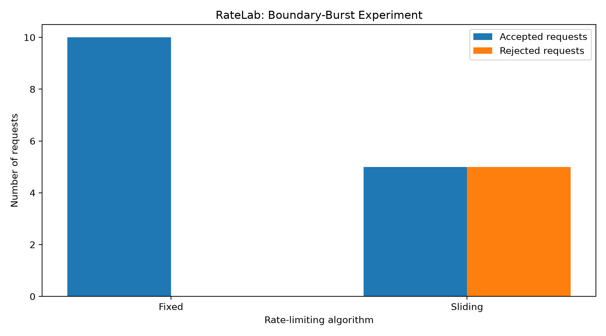

## Research Objective

Compare Fixed Window and Sliding Window rate-limiting algorithms
under different API traffic patterns.

## Research Questions

1. How do the algorithms behave around time-window boundaries?
2. How do they perform under concurrent client traffic?
3. What differences exist in request latency and throughput?
4. What are the CPU and memory costs of each algorithm?

## Experimental Setup

- Language: Go
- State storage: Redis
- Gateway: Go net/http
- Rate limit: 5 requests per 60 seconds per client
- Backend: Local HTTP server
- Algorithms: Fixed Window and Sliding Window

## Metrics

- Accepted and rejected requests
- Rejection rate
- Boundary-burst behavior
- Mean, P50, and P95 latency
- Throughput
- CPU and memory usage

## Limitations

Experiments run on a local machine. Results may vary with machine load,
network conditions, Redis performance, and request concurrency.
## Architecture

RateLab consists of a Go API gateway, a Go backend, and Redis.

- Gateway: http://localhost:8080
- Backend: http://localhost:8081
- Redis: localhost:6379

The gateway checks each client's rate limit before forwarding
requests to the backend.

## Rate-Limiting Algorithms

### Fixed Window

Counts requests within fixed time intervals using Redis counters.
It is simple and efficient, but can allow bursts around window boundaries.

### Sliding Window

Tracks recent request timestamps in a Redis sorted set.
It provides rolling-window enforcement at the cost of additional
Redis operations and state management.

## Configuration

The default limit is five requests per client per 60 seconds.

Select the algorithm with the RATELAB_ALGORITHM environment variable.

Start the Fixed Window gateway:

    RATELAB_ALGORITHM=fixed go run ./cmd/gateway

Start the Sliding Window gateway:

    RATELAB_ALGORITHM=sliding go run ./cmd/gateway

Stop an existing gateway before starting another one on port 8080.

## Running the Project

Start Redis:

    docker compose up -d redis

Run the backend in one terminal:

    go run ./cmd/backend

Run the gateway in another terminal:

    RATELAB_ALGORITHM=fixed go run ./cmd/gateway

Check gateway health:

    curl -s http://localhost:8080/health

Check the backend:

    curl -i http://localhost:8081/health

Run Go tests:

    go test ./...

Build the project:

    go build ./...

## Experiments

The project includes scripts for:

- Basic rate-limit testing
- Concurrent requests
- Boundary-burst testing
- Algorithm comparison
- Performance benchmarking
- Multi-client fairness
- Sustained load
- Resource monitoring

See EXPERIMENT_REPORT.md for recorded results and limitations.

## Experimental Limitations

Performance results are preliminary. Different benchmark scripts
have produced different measurements, and not every historical run
independently verified the active algorithm.

Repeated trials under controlled conditions are required before
drawing strong performance conclusions.

## Boundary-Burst Results

Fixed Window accepted 10 requests across the tested window boundary.
Sliding Window accepted 5 and rejected 5 because the earlier requests
remained within its rolling time window.

## Boundary-Burst Experiment

This experiment compares how Fixed Window and Sliding Window handle
requests arriving on opposite sides of a time-window boundary.

### Recorded results

| Metric | Fixed Window | Sliding Window |
|---|---:|---:|
| Requests before boundary | 5 | 5 |
| Accepted before boundary | 5 | 5 |
| Requests after boundary | 5 | 5 |
| Accepted after boundary | 5 | 0 |
| Total accepted | 10 | 5 |
| Total rejected | 0 | 5 |

In this experiment, Fixed Window accepted both batches because its
counter reset at the boundary. Sliding Window rejected the second
batch because the earlier requests remained within the rolling window.

These findings describe the tested scenario; they are not a general
performance comparison.
